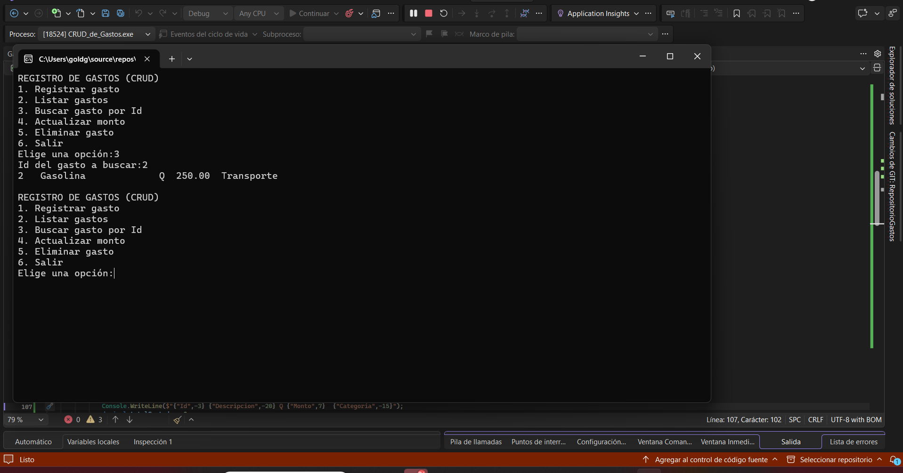
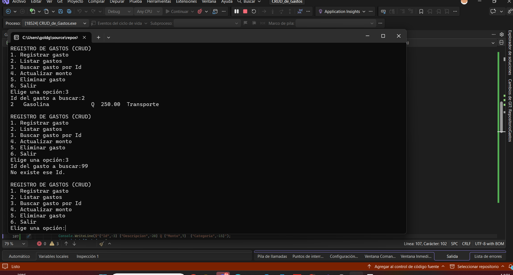
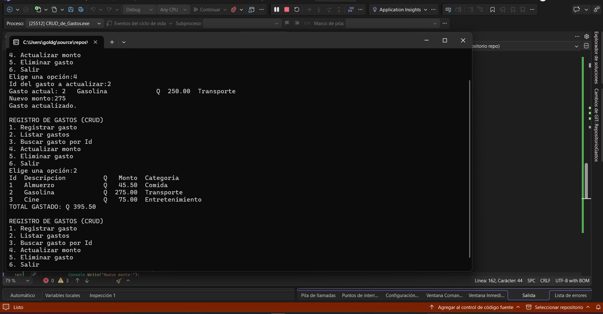
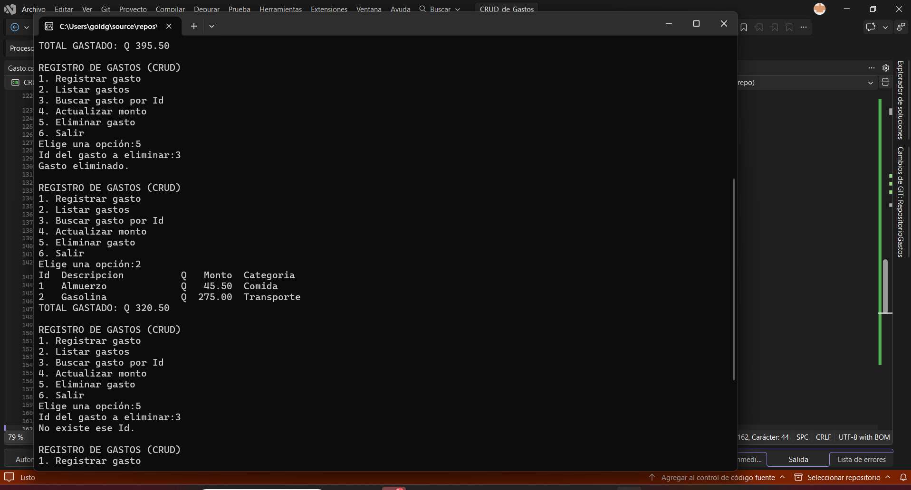
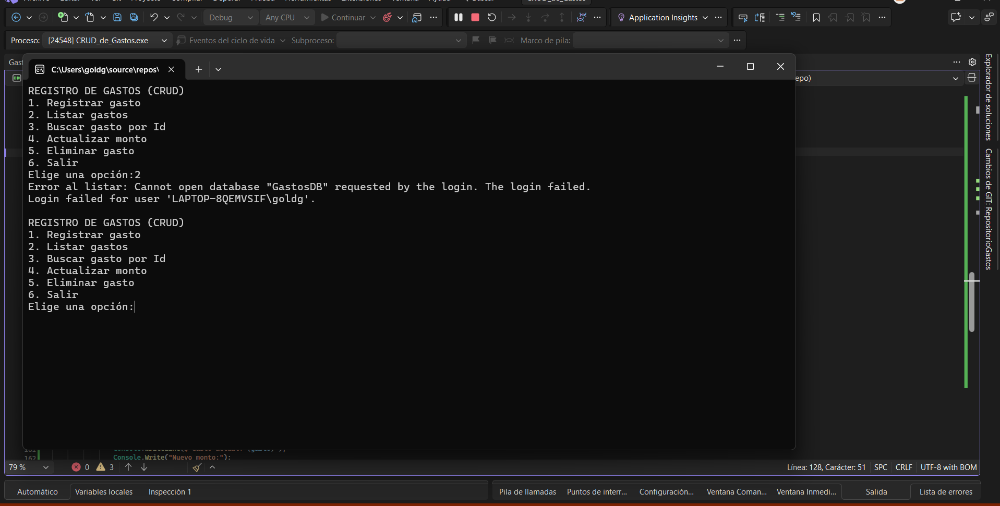

CRUD repositorio gastos

Cómo ejecutarlo:

Abre el proyecto en Visual Studio Community y presiona F5.
O utiliza el comando dotnet run desde la terminal.

Link de la explicacion:
https://drive.google.com/drive/folders/11tfcFvyFLYCaIQ-5DkupvqmiDOUwi9Qe?usp=sharing